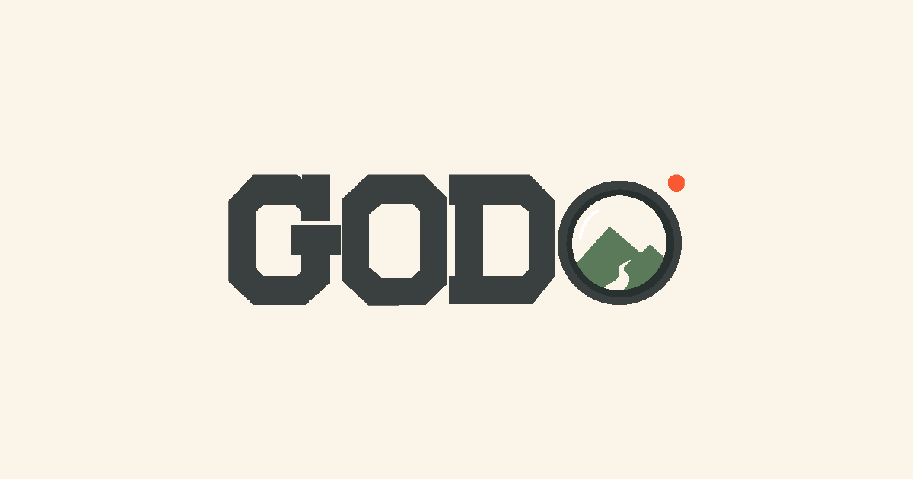

# 고도필름 (GodoFilm)

**찰나의 순간을 나만의 등산필름으로, 고도필름.**

산행 중 원하는 지점에서 3초짜리 영상을 찍고, 촬영 시각과 해발고도, 산별 일러스트를 담은 세로 영상으로 다운로드하는 모바일 웹앱입니다.

[고도필름 열기](https://blueaboveall.github.io/GodoFilm/)



## 사용 방법

1. 휴대폰 브라우저에서 고도필름을 열고 **새 프로젝트 생성**을 누릅니다. 프로젝트 이름을 입력하고 산과 해당 산의 디자인을 선택합니다.
2. 카메라·마이크·위치 권한을 허용합니다. 원하는 지점에서 고도를 확인하고 **REC**를 누르면 3초간 촬영합니다. 전·후면 카메라 전환, 5초·10초 타이머와 배율 옵션을 사용할 수 있습니다.
3. 촬영 화면을 옆으로 밀어 저장된 클립을 확인합니다. 홈에서는 프로젝트 이름을 바꾸거나 프로젝트를 삭제할 수 있습니다.
4. **고도필름 다운로드**를 누르면 클립을 촬영 순서대로 합칩니다. 제작 중에는 미리보기와 진행률을 볼 수 있습니다.

| 산 | 영상 디자인 |
| --- | --- |
| 소래산 · 수락산 · 미륵산 | 산 정상 |
| 배봉산 | 크래프트 (영어) |
| 구름산 | 크래프트 (한글) |

## 기획과 제작

서울시 손목닥터9988을 사용하면서 기록하는 재미가 운동할 계기가 될 수 있다는 점에 관심을 가졌습니다. 아버지가 산에서 찍은 사진을 가족과 공유하던 모습에서 출발해, 산행 중 발견한 풍경을 짧게 촬영하고 한 편으로 남기는 서비스를 만들었습니다.

초기 산행 테스트에서 일행과 함께 화면에 담기 어려워 타이머와 배율 옵션을 추가했습니다. 다운로드를 누른 뒤 작업 상태를 알기 어려웠던 문제는 합성 화면을 미리보기로 보여주고 진행률을 표시하는 방식으로 개선했습니다. 산별 배경은 실제 정상 풍경을 조사해 직접 그렸습니다.

2026년 6월에 기획하고 7~8월에 제작한 개인 프로젝트입니다. 기획, 화면·인터랙션 설계, 그래픽 제작, 테스트와 배포를 직접 맡았으며, 구현에는 Gemini와 Claude를 활용하고 동작을 검수했습니다. [Notion 프로젝트 기록](https://app.notion.com/p/40954fb13cf781ea95c9ed8051ed5237) · [개발 기록](https://app.notion.com/p/41a54fb13cf7818d8671cebce3aefa30) · [제작 자료실](https://app.notion.com/p/41a54fb13cf7812a93c0c49b82070a78)

## 구현 구조

| 파일 | 역할 |
| --- | --- |
| [index.html](index.html) | 홈, 새 프로젝트 바텀 시트, 촬영 화면, 도움말 |
| [style.css](style.css) | 모바일 화면 배치, 안전 영역, 높이에 따른 반응형 스타일 |
| [script.js](script.js) | 프로젝트 관리, 카메라와 고도 조회, 클립 저장·재생, 영상 합성·다운로드 |
| [manifest.json](manifest.json) | PWA 이름, 아이콘, 세로 화면과 독립 실행 설정 |
| [sw.js](sw.js) | 앱의 정적 리소스 캐싱과 이전 고도필름 캐시 정리 |

- **고도 조회** — 브라우저 Geolocation이 제공한 위도·경도를 Open-Meteo Elevation API로 보내 지형의 해발고도를 조회합니다. 위치 권한과 인터넷 연결이 필요하며 서비스 워커는 이 요청을 캐시하지 않습니다.
- **촬영과 저장** — `getUserMedia`로 카메라·마이크 스트림을 열고 `MediaRecorder`로 촬영합니다. 프로젝트 정보는 `localStorage`에, 영상과 촬영 시각·고도·프로젝트 ID·카메라 방향은 IndexedDB의 `HikeCameraDB`에 저장합니다. 현재 DB 업그레이드 코드는 기존 `videos` 저장소를 유지합니다.
- **영상 합성** — 산별 배경, 클립, 촬영 시각과 고도를 1290 × 2622px Canvas에 그립니다. `captureStream(30)`과 `MediaRecorder`로 하나의 영상 파일을 생성합니다. 다음 클립을 미리 로드하고 전환 과정에서 직전 프레임을 유지해 깜빡임을 줄입니다.

## 로컬 실행

HTML·CSS·JavaScript로 구성된 정적 웹앱이며 GitHub Pages로 배포합니다. 별도 빌드 없이 Python 3으로 실행할 수 있습니다.

```bash
git clone https://github.com/blueaboveall/GodoFilm.git
cd GodoFilm
python -m http.server 8000
```

같은 기기에서 `http://localhost:8000`을 엽니다. 카메라·마이크와 위치 권한이 필요한 기능을 휴대폰에서 확인하려면 배포된 HTTPS 주소를 사용하세요.

## 저장 및 내보내기

- 프로젝트와 클립은 사용한 브라우저에 보관됩니다. 기기나 브라우저 간 자동 동기화는 없으며, 사이트 데이터를 삭제하면 저장 기록도 사라질 수 있습니다.
- 최종 영상은 Canvas의 영상 트랙으로 합성되므로 원본 오디오는 포함되지 않습니다.
- 브라우저의 녹화 지원에 따라 결과가 MP4 또는 WebM일 수 있습니다. 현재 다운로드 파일명은 `.mp4`로 고정되어 있어 실제 형식과 확장자가 다를 수 있습니다.
